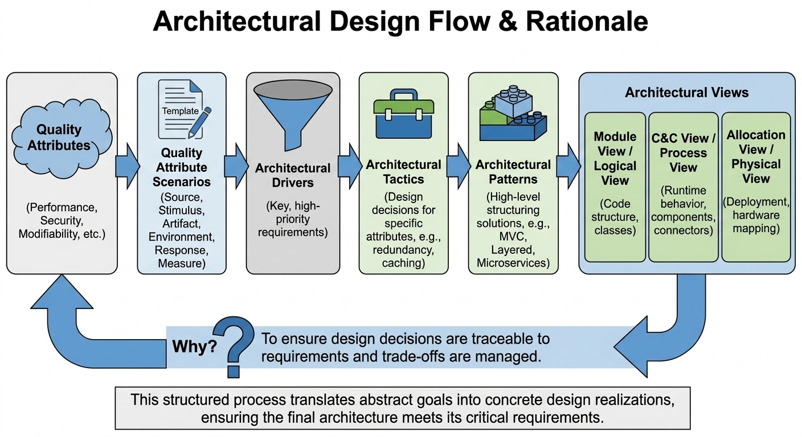
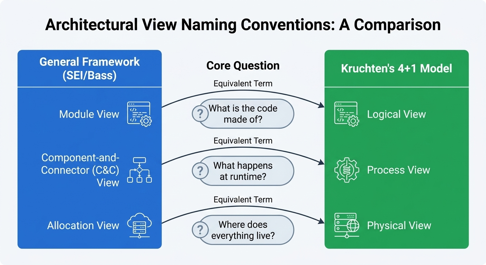
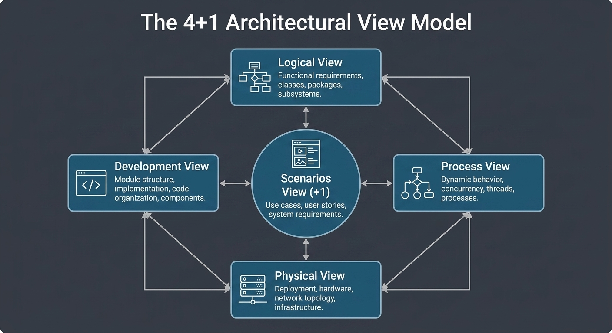

# TDT4240 Software Architecture

[← All courses](../readme.md)

Based on previous exam questions in the NTNU course [TDT4240 Software Architecture](https://www.ntnu.edu/studies/courses/TDT4240). Companion compendium: [Wikipendium – TDT4240 Software Architecture](https://www.wikipendium.no/TDT4240_Software_Architecture).

**Content:**
- Definitions, importance and the influence cycle of software architecture (Bass, Clements and Kazman)
- Architectural views: module, component-and-connector, allocation
- Quality attributes, scenarios and response measures (including usability, performance and security)
- Architectural patterns vs design patterns vs idioms; patterns for games, pipelines, layering and brokers
- Attribute-Driven Design (ADD) and software architecture reconstruction
- Evaluation methods: ATAM and CBAM; IEEE 1471 / ISO/IEC/IEEE 42010
- Software product lines and scope
- Game architecture (decoupled game loop) and ecosystem/Metropolis structures
- Cloud computing: SaaS, PaaS and IaaS, economic justifications, hypervisors

**Learning outcomes:**
- Recognise and apply core architectural concepts, patterns and tactics
- Analyse and evaluate architectures using quality attribute scenarios, ATAM and CBAM
- Document architectures using the three views and standard notations
- Reason about cloud deployments and virtualisation at an architectural level

  
  
  

## Contents

- [Exam 2018](#exam-2018)
- [Exam 2019 – Part 1](#exam-2019--part-1)
- [Exam 2019 – Part 2](#exam-2019--part-2)
- [Exam 2020](#exam-2020)
- [Exam 2025](#exam-2025)

## Quizzes

### Exam 2018

*The 2018 exam, Part 1 (Problems 1–3, first 28 questions). The exam and solution papers are on NTNU Blackboard ([exam](https://ntnu.blackboard.com/bbcswebdav/pid-2980895-dt-content-rid-89339566_1/xid-89339566_1), [solutions](https://ntnu.blackboard.com/bbcswebdav/pid-2980895-dt-content-rid-89339567_1/xid-89339567_1); NTNU login required).*

**Quiz:** [Software Architecture – Exam 2018](https://dev-quizmachine.itautomasjon.no/Quiz/Take/tdt4240-1)

| Topic | Details |
|---|---|
| **SA definition (Bass/Clements/Kazman)** | System structures: elements, externally visible properties, relationships     |
| **Decoupled game loop**               | Separate update from render; fixed-timestep simulation independent of FPS       |
| **SPL scope**                         | Too narrow → limits reuse; too broad → dilutes commonality                      |
| **QA scenarios (6 parts)**            | Source, Stimulus, Artifact, Environment, Response, Response Measure             |
| **Usability response measures**       | E.g. task time, error rate, learning time, satisfaction                         |
| **Importance of architecture**        | Identify which reason is **NOT** in the textbook list                           |
| **Architecture influence cycle**      | Stakeholders ↔ requirements ↔ architect ↔ system ↔ environment (feedback)       |
| **Three views**                       | Module / Component-and-Connector / Allocation + typical UML notations           |
| **Security tactics (4 groups)**       | Detect, Resist, React, Recover                                                  |
| **ATAM outputs**                      | Utility tree, scenarios, risks, non-risks, sensitivity & tradeoff points        |
| **Performance analytic models**       | Queuing theory, scheduling theory                                               |
| **ADD steps**                         | Choose element → drivers → patterns/tactics → instantiate → interfaces → verify → recurse |
| **Reconstruction process (4 steps)**  | Information extraction → DB construction → View fusion → Reconstruction         |
| **Why reconstruct**                   | Lost/outdated docs, conformance checking, evolution & reengineering             |
| **ATAM vs CBAM**                      | ATAM = quality-attribute tradeoff/risk; CBAM = adds cost-benefit economics      |
| **Metropolis (ecosystem-dominant)**   | Core, contributors, periphery, end users                                        |
| **IEEE 1471 / ISO 42010**             | Standard: stakeholders, concerns, viewpoints, views                             |
| **Code↔architecture consistency**     | Reflexion models, layer enforcement, reviews, generated/embedded architecture   |
| **Observer pattern**                  | One-to-many notification; decouples subject from observers                      |
| **Patterns vs design patterns vs idioms** | System structure vs recurring designs vs language-specific tricks           |
| **Pattern picks (Problem 2)**         | Tiered system → **Client-Server/N-tier**; seismic stages → **Pipe-and-Filter**; AI strategy levels → **Layered/Blackboard**; engine multi-API → **Layered**; payment integration → **Broker** |
| **SaaS / PaaS / IaaS**                | Apps (Gmail, Salesforce) / platform (App Engine, Heroku) / infra (EC2, Azure VM) |
| **Cloud economics**                   | Pay-per-use, elasticity, economies of scale                                     |
| **Hypervisor**                        | Virtualises hardware → multiple guest OSes per host (hardware → hypervisor → VMs) |

[↑ Back to top](#tdt4240-software-architecture)

### Exam 2019 – Part 1

*12 questions from Part 1 of the 2019 exam.*

**Quiz:** [Software Architecture – Exam 2019, Part 1](https://dev-quizmachine.itautomasjon.no/Quiz/Take/tdt4240-2)

| Topic | Details |
|---|---|
| **QA scenario (6 parts)**             | Source, Stimulus, Environment, Artifact, Response, Response Measure             |
| **Three views**                       | Allocation = mapping to env. structures; C&C = runtime behaviour & interactions; Module = static implementation units |
| **Utility tree (ATAM)**               | Prioritises QA scenarios (importance × difficulty); drives ATAM analysis        |
| **Pattern by view type**              | Module → layered; C&C → client-server (or pipe-and-filter); Allocation → multi-tier (deployment) |
| **Why architecture matters (5)**      | Enables/constrains QAs; locks in early decisions; mirrors org structure; supports estimation/planning; aids communication & onboarding |
| **Four contexts**                     | Technical (QAs, tech stack); Project life cycle (process model); Business (goals, time-to-market); Professional (architect skills/knowledge) |
| **Availability tactics**              | Fault detection (ping/echo, monitor, voting); Recovery–preparation (redundancy, spare, exceptions); Recovery–reintroduction (shadow, resync, escalating restart); Prevention (removal, transactions, predictive model) |
| **Interoperability**                  | Degree to which two or more systems can usefully exchange information           |
| **Abstract Factory**                  | Family of related classes with different implementation details; client uses abstract interface, unaware of variant |
| **Performance model inputs**          | Arrival rate, service time (also: queue size, priority, scheduling policy)      |
| **Architectural pattern**             | Recurring design decisions; package of solutions for system construction; defines element types and their relationships |
| **Availability analytic models**      | Stochastic / probabilistic models (e.g. Markov) and reliability models          |

[↑ Back to top](#tdt4240-software-architecture)

### Exam 2019 – Part 2

*The rest of Part 1, plus Problem 2 (pattern selection), Problem 3 (QA scenarios for the Norwegian health portal) and two bonus questions on the "Big 7" quality attributes.*

**Quiz:** [Software Architecture – Exam 2019, Part 2](https://dev-quizmachine.itautomasjon.no/Quiz/Take/TDT4240-3)

| Topic | Details |
|---|---|
| **ATAM tradeoff point**               | Decision affecting **two or more quality attributes** at once (positive and negative) |
| **Cloud service models**              | SaaS = consumer apps on cloud; PaaS = dev/deploy platform; IaaS = VM for dev/sysadmin |
| **Multi-tenancy**                     | Same **infrastructure / application instance** shared by many consumers          |
| **Hypervisor**                        | Software (VMM) that creates and manages virtual machines                        |
| **Pattern picks (Problem 2)**         | 1. DB/logic/UI/client tiers → **multi-tier**; 2. seismic stages → **pipe-and-filter**; 3. AI strategy levels → **layered**; 4. shared compute/storage with load balancing → **peer-to-peer**; 5. external payment integration → **broker** |
| **QA scenario – usability (health portal)** | E.g. *Source:* user; *Stimulus:* wants to view test results; *Environment:* runtime/normal; *Artifact:* portal UI; *Response:* user finds & opens results; *Measure:* ≤ 3 clicks / ≤ 30 s |
| **QA scenario – availability**        | E.g. *Source:* server/network; *Stimulus:* component fails; *Environment:* normal operation; *Artifact:* portal service; *Response:* failover, log, notify; *Measure:* ≥ 99.9% uptime / recover < 1 min |
| **QA scenario – security**            | E.g. *Source:* unauthorised user; *Stimulus:* attempts to access health data; *Environment:* online; *Artifact:* data store / auth service; *Response:* deny, log, alert; *Measure:* 0 unauthorised reads, alert < 1 min |
| **Big 7 quality attributes**          | Availability, Interoperability, Modifiability, Performance, Security, Testability, Usability |
| **6 parts of a QA scenario**          | source, stimulus, artifact, environment, response, response measure              |

[↑ Back to top](#tdt4240-software-architecture)

### Exam 2020

*A full rehearsal of the 2020 exam. Problem 1 walks through designing the Distributed Board Game Platform (DBGP) end to end (ASRs, patterns, tactics, logical view, process view, rationale). Problem 2 covers architecture for the edge.*

**Quiz:** [Software Architecture – Exam 2020](https://dev-quizmachine.itautomasjon.no/Quiz/Take/tdt4240-4)

| Topic | Details |
|---|---|
| **DBGP case overview**                                 | Centralized node hosts rules, assets, game state, auth, notification; player and bot clients connect over the Internet |
| **Primary focus of architectural design**              | Deciding system structures (elements, relationships, properties) to satisfy quality requirements |
| **"Motivate choices / state assumptions"**             | Explain *why* each structural decision was made; document any constraints assumed from the problem text |
| **Input: ASRs (Architecturally Significant Requirements)** | Requirements with the biggest structural impact; for DBGP: High Availability, Extreme Flexibility (runtime updates and new games), Centralized Communication |
| **Input: Quality Attributes**                          | Formal QAs derived from the text: Availability and Modifiability; Performance is explicitly *not* prioritized |
| **Input: Stakeholders**                                | Human Players (easy gameplay), Bot Developers (configuration and standard APIs), System Administrators (zero-downtime updates) |
| **Structural decisions: patterns**                     | Client-Server (overall), Publish-Subscribe (notification service), Broker (routing game messages), Blackboard (shared centralized state) |
| **Structural decisions: views**                        | Viewpoint = rules for drawing; View = actual diagram; C&C view shows runtime communication between DBGP Server, Database, Player App, and Bot PC |
| **Consistency among views**                            | Every element in one view (e.g., Notification Event Bus in C&C) must appear in all other views that show it (e.g., Module view code package) |
| **Quality tactics: Availability**                      | Heartbeat (detect server liveness), Active Redundancy / hot-spare (failover with no downtime) |
| **Quality tactics: Modifiability**                     | Semantic Coherence (all game rules in one module), Abstract Interfaces (uniform API for player apps and bots), Defer Binding (runtime updates without node restart) |
| **Quality tactics: Security**                          | Authenticate Actors (username/password before centralized node access) |
| **Quality tactics: Testability**                       | Record / Playback (capture and replay game sessions to locate faults) |
| **Quality tactics: Usability**                         | Maintain User Model (personalize UI and adapt game experience per player) |
| **Why Blackboard for DBGP**                            | Centralized node acts as shared data repository; multiple independent knowledge sources (player apps, bot apps, game engine) read and write state; matches the case's centralized-communication ASR |
| **Blackboard drawbacks**                               | Single point of failure; potential bottleneck; complex to synchronize competing writers; hard to test in isolation |
| **Big 10 quality attributes**                          | Availability, Interoperability, Modifiability, Performance, Security, Testability, Usability, Safety, Energy Efficiency, Deployability |
| **QAS – Usability (DBGP)**                             | *Source:* first-time user; *Stimulus:* wants to log in, choose and play a game without help; *Environment:* runtime/normal; *Artifact:* Player client UI; *Response:* user completes all steps unaided; *Measure:* task completed within a defined time with no errors |
| **QAS – Availability (DBGP)**                          | *Source:* hardware fault; *Stimulus:* hard drive on centralized node crashes; *Environment:* normal operation; *Artifact:* centralized node; *Response:* hot-spare takes over automatically; *Measure:* zero perceived downtime for players and bots |
| **QAS – Modifiability (DBGP)**                         | *Source:* developer; *Stimulus:* wants to add a new board game (rules, assets, data already prepared); *Environment:* runtime; *Artifact:* centralized node; *Response:* new game deployed without restarting the node; *Measure:* node stays online; new game available within defined deployment window |
| **ASRs for DBGP (Problem 1b)**                         | High Availability of centralized node; transaction support for data consistency; authentication of users and bots; runtime updates and new-game deployment without node changes; concurrent sessions and notification service; distributed nature requires testability/fault localization |
| **ASR-to-QA mapping**                                  | Always-on node → Availability; transaction support → Integrity (Availability); authentication → Security; runtime updates / new games → Modifiability; concurrent sessions and notifications → Availability; distributed fault isolation → Testability |
| **MVC placement in DBGP**                              | Model lives on the centralized node (game state, rules, assets); View lives on the client (Player UI); Controller lives on the client (processes user input and calls server API) |
| **Logical view – patterns and tactics**                | Blackboard (main), Publish-Subscribe / Observer (notifications), Broker (routing), Abstract Interfaces, Defer Binding, MVC |
| **Observer in DBGP**                                   | Centralized node (subject) notifies registered Player and Bot clients (observers) whenever game state changes |
| **Centralized-node services**                          | Authentication Service (verify identity); Notification Service (push updates to clients); Session Management (track ongoing game sessions); Database / Transaction Service (consistent read/write with ACID); Game Engine Service (apply rules, update game state) |
| **Process view: fail-over trigger**                    | Heartbeat monitor on a separate node detects missed heartbeats from the primary centralized node and promotes the hot-spare |
| **Heartbeat listener on separate node**                | Avoids single point of failure; an observer on the same failing node could not reliably detect or act on its own crash |
| **Player client states**                               | Login, Create User, Select Game, Play Game |
| **Bot client states**                                  | Login, Configure AI, Select Game, Play Game |
| **Rationale: Availability mechanisms**                 | Active Redundancy (hot-spare node), Heartbeat (liveness detection), Transactions (data consistency across failover) |
| **Rationale: Modifiability mechanisms**                | Defer Binding (runtime plugin / dynamic loading), Abstract Interfaces (stable API contract), Semantic Coherence (game rules isolated in one deployable module) |
| **Edge computing (Problem 2) – key concerns**          | Constrained resources, intermittent connectivity, physical security, heterogeneous hardware, remote deployment/update |
| **Edge tactics by QA**                                 | Heartbeat → Availability; Active Redundancy → Availability; Defer Binding → Modifiability; Authenticate Actors → Security; Detect Intrusion → Security; Record / Playback → Testability; Limit Event Response → Performance; Increase Resources → Performance |
| **Edge architectural patterns**                        | Client-Server, Publish-Subscribe, Pipe-and-Filter, Broker, Layered |
| **Edge design patterns**                               | Observer, Singleton, Proxy, Template Method |
| **Not an architectural diagram or pattern**            | Class diagram (a design / documentation artefact, not an architectural pattern or view type) |

[↑ Back to top](#tdt4240-software-architecture)

### Exam 2025

*A full rehearsal of the 2025 exam, focusing on QA scenario construction, ASR identification, tactics and patterns, Kruchten 4+1 views (physical and logical) and architectural rationale.*

**Quiz:** [Software Architecture – Exam 2025](https://dev-quizmachine.itautomasjon.no/Quiz/Take/tdt4240-5)

| Topic | Details |
|---|---|
| **Three primary quality attributes**                   | Safety (collision avoidance), Availability (real-time hub and mobile unit connectivity), Performance (route optimisation, low-latency control) |
| **Why Safety is architecturally significant**          | Autonomous systems operate in populated urban/suburban areas; collision or crash endangers people and property; regulatory approval depends on demonstrated safety |
| **Why Availability is architecturally significant**    | Continuous status reporting from all mobile units to the hub is required; hub downtime or communication loss can interrupt active operations |
| **Quality attribute**                                  | Modifiability (important but not among the top three given the safety-critical, real-time nature of the system) |
| **6 parts of a QA scenario**                           | Source of stimulus, Stimulus, Environment, Artifact, Response, Response Measure |
| **Safety scenario – stimulus**                         | A mobile unit detects an obstacle or another unit on collision course during operation |
| **Safety scenario – valid measurable response**        | The unit executes evasive manoeuvre and no collision occurs within 200 ms of detection |
| **Availability scenario – response measure**           | Quantified recovery time and/or percentage uptime (e.g., hub recovers within 5 s; 99.99% uptime) |
| **Performance scenario – artifact**                    | Hub route-optimisation service (or the onboard Flight Manager) |
| **Representative ASRs**                                | Real-time obstacle avoidance; continuous hub to unit communication; dynamic rerouting on weather/technical faults; unit assignment based on battery/weight/location; regulatory coordination; secure authentication of units and users; scalable multi-city deployment from a single shared hub |
| **Security tactic (primary)**                          | Authenticate Actors (prevent unauthorised access to backend services) |
| **Availability tactics**                               | Heartbeat (monitor unit and hub liveness), Active Redundancy (hot-spare hub), Exception Handling, Transactions |
| **Modifiability tactic**                               | Use an Intermediary / Abstract Interface (reduce coupling between modules so individual components can be replaced independently) |
| **Performance tactics**                                | Limit Event Response (rate-limit low-priority telemetry), Increase Resources (scale hub compute for peak load), Schedule Resources (prioritise safety-critical messages) |
| **Security tactic: Limit Access**                      | Primarily promotes Security (restricts what authenticated actors can do once inside the system) |
| **Kruchten 4+1 views**                                 | Logical (components and their responsibilities), Development/Implementation (code packages), Process (runtime threads and interactions), Physical (deployment to hardware nodes), Use-Case (+1, drives the others) |
| **4+1 view for runtime processes and threads**         | Process view |
| **4+1 view for deployment across mobile units, clients and servers** | Physical view |
| **Top-level logical components**                       | App/Web client, Hub (order management, routing, weather, airspace), onboard unit system |
| **Runtime components on the unit**                     | Flight Manager, Sensor Manager, Communication Module, Obstacle Detection Module, Package Delivery Controller |
| **Flight Manager – Sensor Manager interaction style**  | Procedure call / synchronous request-reply (the flight controller polls sensor data on each control cycle to make immediate navigation decisions) |
| **Pattern for incident response flow (app, unit, backend)** | Publish-Subscribe (each party subscribes to incident events; the hub publishes alerts; units and the app react independently) |
| **Modularisation rule for Modifiability**              | High cohesion within modules, loose coupling between modules; encapsulate variability behind stable interfaces (Abstract Interfaces tactic) |
| **Drawback of Publish-Subscribe for real-time control** | Non-deterministic delivery latency; a broker adds a hop and cannot guarantee message delivery within a hard deadline required for safety-critical control loops |
| **Message broker properties (Pub-Sub)**                | Decouples producers from consumers; supports topic-based routing; provides buffering / persistence; enables fan-out to multiple subscribers |
| **Benefit of well-defined API contracts**              | Components can evolve independently; teams can develop in parallel; integration testing is simplified; contract violations are caught early |
| **Pattern for mobile app to backend requests**         | Client-Server (the app sends requests; the hub responds); optionally a REST/HTTP API gateway in front of the hub services |
| **Practices for high cohesion and loose coupling**     | Single-responsibility modules; dependency injection; interface-based programming; event-driven communication for non-time-critical paths |
| **Key architectural trade-off**                        | Performance vs Safety: aggressive low-latency optimisations (e.g., skipping confirmations) can compromise the safety checks required for autonomous flight |
| **Artefacts in the architecture document**             | QA scenarios, ASR list, architectural views (logical, process, physical), tactical decisions with rationale, pattern selections with justification |
| **Decision-to-QA mapping**                            | Heartbeat → Availability; Authenticate Actors → Security; Abstract Interface / Limit Access → Modifiability; Limit Event Response → Performance; Obstacle detection with evasive manoeuvre → Safety |

[↑ Back to top](#tdt4240-software-architecture)
